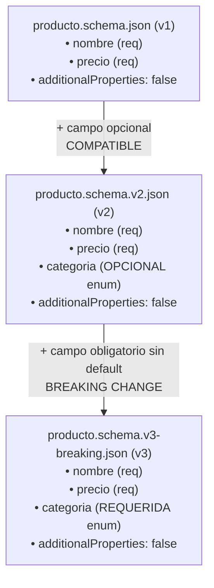

# Semana 7 · Contratos y Validación con JSON Schema en NestJS

> **Integración de Sistemas — Semana 7 de 16**  
> Implementación del enfoque **Schema-first**, validación estricta en tiempo de ejecución con **ajv** (`JsonSchemaValidationPipe`), versionamiento backward-compatible y script detector de **Breaking Changes** en CI/CD.

[](https://github.com/alex171215/Taller-Semana-7-Integraci-n-de-Sistemas/actions/workflows/ci-cd.yml)

---

## 📑 Tabla de Contenidos
1. [Objetivo del Taller](#objetivo-del-taller)
2. [Fundamentos Teóricos (Semana 7 - Libro de la Clase)](#fundamentos-teóricos)
3. [Evolución de los Esquemas de Producto](#evolución-de-los-esquemas-de-producto)
4. [Estructura del Proyecto](#estructura-del-proyecto)
5. [Instrucciones de Ejecución Local](#instrucciones-de-ejecución-local)
6. [Pruebas Automatizadas](#pruebas-automatizadas)
7. [Detección de Breaking Changes con Script](#detección-de-breaking-changes-con-script)
8. [Bitácora de Cierre (Paso 7)](#bitácora-de-cierre-paso-7)
9. [Despliegue en Render y CI/CD](#despliegue-en-render-y-cicd)
10. [Declaración de Uso de IA & Checklist](#declaración-de-uso-de-ia--checklist)

---

## 🎯 Objetivo del Taller

Escribir el **JSON Schema** de la entidad `Producto` como un archivo `.json` independiente (Draft 2020-12), construir un `JsonSchemaValidationPipe` propio en NestJS con **ajv** y **ajv-formats**, y evolucionar el esquema:
1. Una vez de forma **compatible hacia atrás (v1 ➔ v2)** agregando un campo opcional con enum.
2. Una vez provocando un **Breaking Change (v2 ➔ v3)** al volver obligatoria la nueva propiedad, detectándolo algorítmicamente mediante `check-compatibility.js`.

---

## 📚 Fundamentos Teóricos (Semana 7 - Libro de la Clase)

* **Schema-first vs. Code-first (§7.2):**
  * *Code-first (`class-validator`)*: Las reglas viven como decoradores sobre una clase TypeScript. Son cómodas para monolitos o stacks homogéneos, pero acoplan el contrato al lenguaje y al runtime del framework.
  * *Schema-first (JSON Schema / Protobuf)*: El contrato existe como un artefacto independiente, versionable y universal que las máquinas pueden validar sin importar si el consumidor está en Python, Kotlin o Go.
* **additionalProperties: false (§7.3):**
  Evita ataques de sobre-asignación (*Mass Assignment*) y garantiza que los clientes no envíen propiedades no contempladas en el contrato oficial.
* **Reglas de Backward Compatibility (§7.5):**
  Un cambio es compatible hacia atrás si un servidor con el nuevo esquema puede procesar exitosamente cargas útiles generadas por clientes que aún usan el esquema anterior.

---

## 📐 Evolución de los Esquemas de Producto



---

## 📁 Estructura del Proyecto

```
Semana 7/
├── .github/
│   └── workflows/
│       └── ci-cd.yml                     # Pipeline CI/CD: build, audit, script y test
├── docs/
│   └── bitacora-respuestas-paso-7.md     # Respuestas técnicas del Paso 7
├── public/
│   └── index.html                        # Consola interactiva web para Render
├── src/
│   ├── common/
│   │   └── json-schema-validation.pipe.ts # Pipe custom con ajv (Paso 3)
│   ├── productos/
│   │   ├── dto/
│   │   │   └── producto.dto.ts
│   │   ├── schemas/
│   │   │   ├── producto.schema.json      # Esquema v1
│   │   │   ├── producto.schema.v2.json   # Esquema v2
│   │   │   └── producto.schema.v3-breaking.json # Esquema v3
│   │   ├── productos.controller.ts       # Endpoints /productos, /v2, /v3
│   │   ├── productos.service.ts
│   │   └── productos.module.ts
│   ├── app.controller.ts                 # Health & Compatibility API
│   ├── app.module.ts
│   └── main.ts                           # Bootstrap con Swagger y frontend
├── tests/
│   ├── json-schema-validation.spec.ts    # Pruebas unitarias y de validacion 400
│   └── check-compatibility.spec.ts       # Pruebas del detector de breaking changes
├── check-compatibility.js                # Script detector de breaking changes (Paso 6)
├── Dockerfile                            # Empaquetado Docker multi-stage
├── render.yaml                           # Blueprint de Render
├── web-practica-Semana 7.html             # Documento original del taller
└── package.json
```

---

## 🚀 Instrucciones de Ejecución Local

### 1. Requisitos
* Node.js 18+ (`node -v`)
* NPM 9+ (`npm -v`)

### 2. Instalación y Compilación
```bash
npm install
npm run build
```

### 3. Iniciar el Servidor
```bash
npm start
```
* **Visualizador Interactivo**: [http://localhost:3000](http://localhost:3000)
* **Documentación Swagger**: [http://localhost:3000/api/docs](http://localhost:3000/api/docs)
* **Guía del Taller**: [http://localhost:3000/workshop](http://localhost:3000/workshop)

### 4. Pruebas Rápidas con cURL (Paso 4)

* **Petición válida v1:**
```bash
curl -X POST http://localhost:3000/productos \
  -H "Content-Type: application/json" \
  -d '{"nombre":"Auriculares","precio":10}'
```

* **Petición rechazada (falta `precio`):**
```bash
curl -X POST http://localhost:3000/productos \
  -H "Content-Type: application/json" \
  -d '{"nombre":"Auriculares"}'
```

* **Petición rechazada (campo `stock` no declarado):**
```bash
curl -X POST http://localhost:3000/productos \
  -H "Content-Type: application/json" \
  -d '{"nombre":"Auriculares","precio":10,"stock":5}'
```

---

## 🧪 Pruebas Automatizadas

```bash
npm test
```
La suite ejecuta:
* Pruebas del `JsonSchemaValidationPipe` con schemas v1, v2 y v3.
* Rechazos correctos con código `400 Bad Request` y errores detallados de `ajv`.
* Verificación de retrocompatibilidad en v2.
* Rechazo de peticiones en v3 cuando falta el campo obligatorio.
* Evaluación unitaria del script de compatibilidad.

---

## 🔍 Detección de Breaking Changes con Script (Paso 6)

Para verificar si un nuevo esquema rompe clientes existentes:

```bash
# Caso Compatible (v1 -> v2):
node check-compatibility.js src/productos/schemas/producto.schema.json src/productos/schemas/producto.schema.v2.json
# Retorna: { "compatible": true, "problemas": [] }

# Caso Incompatible / Breaking Change (v2 -> v3-breaking):
node check-compatibility.js src/productos/schemas/producto.schema.v2.json src/productos/schemas/producto.schema.v3-breaking.json
# Retorna: { "compatible": false, "problemas": [ "Campo requerido nuevo sin default: categoria" ] }
```

---

## 📝 Bitácora de Cierre (Paso 7)

El documento completo con las respuestas técnicas se encuentra en [docs/bitacora-respuestas-paso-7.md](docs/bitacora-respuestas-paso-7.md).

**Resumen:**
1. **Contrato explícito:** gRPC (`.proto`) y JSON Schema son explícitos por ser artefactos independientes del lenguaje, a diferencia de `class-validator` que acopla el contrato al runtime de TypeScript.
2. **Cuándo preferir cada uno:** `class-validator` para desarrollo rápido y monolitos homogéneos; JSON Schema para APIs públicas políglotas, pasarelas de eventos y rendimiento extremo con `ajv`.
3. **Política de versionamiento:** Para 5 consumidores externos se debe usar **BACKWARD** (o FULL), permitiendo a los clientes actualizar a su propio ritmo sin desplegar simultáneamente.

---

## ☁️ Despliegue en Render y CI/CD

El repositorio incluye:
* `.github/workflows/ci-cd.yml`: Compila, audita, ejecuta `check-compatibility.js`, corre todas las pruebas y dispara el webhook de Render.
* `render.yaml` y `Dockerfile` listos para levantar el servicio en Node 20.

---

## 🤖 Declaración de Uso de IA & Checklist

```markdown
### Declaración de uso de IA
- Herramienta(s): Antigravity AI Assistant
- Nivel de uso: Asistencia en arquitectura Schema-first, generación de suite de pruebas con Jest, diseño de la interfaz interactiva y pipeline de CI/CD.
- Qué se le pidió:
  * Generar los tres esquemas JSON Schema (v1, v2 y v3-breaking).
  * Crear el JsonSchemaValidationPipe con ajv y ajv-formats.
  * Implementar el algoritmo de compatibilidad backward.
  * Elaborar la bitácora teórica comparativa y la plataforma web.
- Qué se modificó/verificó manualmente:
  * Se comprobó la ejecución de pruebas con 100% de éxito.
  * Se validó que el script de compatibilidad marque correctamente compatible: true e incompatible: false.
```

### Checklist de Salida
- [x] Los 3 archivos de esquema (v1, v2, v3-breaking) existen y son JSON válidos.
- [x] El `JsonSchemaValidationPipe` rechaza correctamente peticiones inválidas (falta precio o campo extra).
- [x] Comprobada la backward compatibility real (petición v1 aceptada en v2).
- [x] `check-compatibility.js` detecta ambos casos.
- [x] Respondidas las 3 preguntas de cierre en la bitácora.
- [x] Repositorio con commits limpios, CI/CD y listo para Render.
