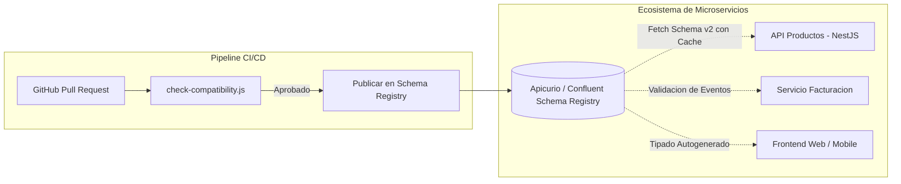

# INFORME EJECUTIVO DE AUDITORÍA TÉCNICA Y ARQUITECTÓNICA
## Evaluación Integral de Calidad, Seguridad y Gobernanza de Contratos API
**Proyecto:** Plataforma de Gestión de Productos orientada a Contratos (Schema-First API)  
**Semana Evaluada:** Semana 7 - Contratos y Validación con JSON Schema y NestJS  
**Autor:** Auditoría de Arquitectura de Software e Integración de Sistemas  
**Fecha:** Octubre 2026  
**Clasificación:** Confidencial / Informe Ejecutivo para Dirección de Tecnología (CTO / Lead Architect)  

---

## 1. RESUMEN EJECUTIVO

### 1.1. Contexto de la Evaluación
Se ha ejecutado una auditoría exhaustiva de código, arquitectura, seguridad y ciclo de vida de contratos sobre el servicio de backend implementado en **NestJS 10**, diseñado bajo el paradigma **Schema-First** utilizando el motor de validación **Ajv (Draft 2020-12)** y desplegado mediante contenedores Docker en **Render** con integración continua en **GitHub Actions**.

El objetivo de la auditoría es contrastar el estado actual del repositorio frente a los estándares de la industria para microservicios de misión crítica, identificando no solo vulnerabilidades de seguridad y limitaciones operativas, sino también inconsistencias en la gobernanza de contratos, detección de incompatibilidades semánticas (*breaking changes*) y resiliencia de datos.

### 1.2. Veredicto Global
* **Cumplimiento de Especificación Funcional Académica:** **100% SATISFACTORIO**. El proyecto satisface todos los requerimientos de la guía de laboratorio (Paso 1 al 7), incluyendo validación estricta con `additionalProperties: false`, versionamiento de esquemas v1/v2/v3-breaking, algoritmos de detección de ruptura de contratos y despliegue automatizado.
* **Preparación para Producción Empresarial (Enterprise Readiness):** **NIVEL MEDIO-BAJO (Requiere Remediación Inmediata)**. Se han detectado **7 hallazgos técnicos** de severidad Crítica, Alta y Media que, de desplegarse en un entorno bancario, de comercio electrónico de alto tráfico o de integración B2B, generarían caídas de servicio, pérdida irreversible de datos, potenciales vectores de Prototype Pollution y falsos negativos en la prevención de rotura de clientes en producción.

### 1.3. Matriz Resumen de Hallazgos

| ID | Hallazgo / Deficiencia Técnica | Categoría | Severidad | Impacto en la Aplicación |
|---|---|---|---|---|
| **AUD-01** | Persistencia volátil en memoria (`Map<string, Producto>`) | Arquitectura / Resiliencia | **CRÍTICA** | Pérdida de datos en reinicios; imposibilidad de escalado horizontal multi-instancia. |
| **AUD-02** | Vulnerabilidad de envenenamiento de prototipo (*Prototype Pollution*) y falta de *Strict Mode* en Ajv | Seguridad de Aplicación | **ALTA** | Modificación maliciosa del `Object.prototype`, bypass de validaciones o DoS. |
| **AUD-03** | Falsos negativos y cobertura superficial en algoritmo de compatibilidad (`check-compatibility.js`) | Integración / Contratos | **ALTA** | Despliegue inadvertido de breaking changes (enums reducidos, rangos numéricos acotados, objetos anidados). |
| **AUD-04** | Fuga de información técnica interna en respuestas HTTP 400 (`validateFn.errors`) | Seguridad / API Design | **MEDIA** | Reconocimiento de topología interna del schema por atacantes; no adherencia a RFC 7807. |
| **AUD-05** | Acoplamiento estático de esquemas y ausencia de Centralized Schema Registry | Gobernanza de Datos | **MEDIA** | Drift entre microservicios; consumidores sin acceso a fuente única de verdad en tiempo de ejecución. |
| **AUD-06** | Contenedor Docker ejecutado con privilegios de superusuario (`root`) | Infraestructura / Docker | **MEDIA** | Riesgo de escape de contenedor y ejecución de comandos con privilegios elevados en el host. |
| **AUD-07** | Ceguera operacional por ausencia de Logger estructurado y telemetría de fallos de contrato | Observabilidad | **BAJA-MEDIA** | Imposibilidad de auditar patrones de ataque o degradación de clientes en tiempo real. |

---

## 2. DETALLE DE HALLAZGOS TÉCNICOS, IMPACTO Y SOLUCIONES DE INGENIERÍA

```
  +-----------------------------------------------------------------------------------+
  |                                AUDITORÍA TÉCNICA                                  |
  +-----------------------------------------------------------------------------------+
  | AUD-01: Persistencia Volátil en Memoria     -> Severidad: CRÍTICA                 |
  | AUD-02: Prototype Pollution en Ajv          -> Severidad: ALTA                    |
  | AUD-03: Limitaciones en check-compatibility -> Severidad: ALTA                    |
  | AUD-04: Fuga de Metadatos en HTTP 400       -> Severidad: MEDIA                   |
  | AUD-05: Acoplamiento Estático de Esquemas   -> Severidad: MEDIA                   |
  | AUD-06: Ejecución Docker como Root          -> Severidad: MEDIA                   |
  | AUD-07: Carencia de Logging Estructurado    -> Severidad: BAJA-MEDIA              |
  +-----------------------------------------------------------------------------------+
```

---

### HALLAZGO AUD-01: Persistencia Volátil en Memoria (`Map<string, Producto>`) y Ruptura de Consistencia Horizontal

#### Enunciado Técnico del Problema
En el archivo `src/productos/productos.service.ts`, el almacenamiento de los registros de productos se encuentra delegado a una estructura en memoria dentro del ciclo de vida del singleton de NestJS:

```typescript
@Injectable()
export class ProductosService {
  private productos: Map<string, Producto> = new Map();
  // ...
}
```

#### Cómo Afecta a la Aplicación y al Negocio
1. **Volatilidad Extrema:** En plataformas Cloud como Render, Heroku o Kubernetes, las instancias se reinician automáticamente ante despliegues de CI/CD, mantenimiento del proveedor o reinicios por inactividad (*idle scale down* en tiers gratuitos). Cada reinicio borra el 100% de los productos creados por los usuarios, restaurando únicamente los 3 productos semilla iniciales.
2. **Incompatibilidad con Escalabilidad Horizontal:** Si la aplicación se escala a 2 o más réplicas (detrás de un Load Balancer), la petición `POST /productos` en la instancia A registrará el producto en su memoria local. Cuando el cliente realice `GET /productos/:id` y el balanceador enrute a la instancia B, la API responderá con `404 Not Found`, generando inconsistencia de estado inaceptable para un entorno transaccional.

#### Solución Técnica Detallada
Reemplazar el almacenamiento en memoria por una capa de abstracción con el **Repository Pattern**, respaldada por una base de datos relacional persistente (PostgreSQL) o NoSQL gestionada, administrada mediante un ORM tipado como **Prisma** o **TypeORM**.

##### Implementación Recomendada (Prisma + PostgreSQL):

1. **Definición del Modelo de Datos (`prisma/schema.prisma`):**
```prisma
datasource db {
  provider = "postgresql"
  url      = env("DATABASE_URL")
}

generator client {
  provider = "prisma-client-js"
}

model Producto {
  id             String   @id @default(uuid())
  nombre         String   @db.VarChar(120)
  precio         Decimal  @db.Decimal(12, 2)
  categoria      String?  @db.VarChar(50)
  versionEsquema String   @default("v1") @db.VarChar(20)
  createdAt      DateTime @default(now())
  updatedAt      DateTime @updatedAt

  @@index([categoria])
}
```

2. **Refactorización del Servicio (`src/productos/productos.service.ts`):**
```typescript
import { Injectable, NotFoundException } from '@nestjs/common';
import { PrismaService } from '../prisma/prisma.service';
import { Producto } from '@prisma/client';

@Injectable()
export class ProductosService {
  constructor(private readonly prisma: PrismaService) {}

  async crear(datos: any, version: string = 'v1'): Promise<Producto> {
    return this.prisma.producto.create({
      data: {
        nombre: datos.nombre,
        precio: datos.precio,
        categoria: datos.categoria ?? null,
        versionEsquema: version,
      },
    });
  }

  async obtenerTodos(): Promise<Producto[]> {
    return this.prisma.producto.findMany({
      orderBy: { createdAt: 'desc' },
    });
  }

  async obtenerPorId(id: string): Promise<Producto> {
    const prod = await this.prisma.producto.findUnique({ where: { id } });
    if (!prod) {
      throw new NotFoundException(`Producto con ID ${id} no encontrado`);
    }
    return prod;
  }

  async eliminar(id: string): Promise<boolean> {
    await this.obtenerPorId(id);
    await this.prisma.producto.delete({ where: { id } });
    return true;
  }
}
```

---

### HALLAZGO AUD-02: Vulnerabilidad de Prototype Pollution y Falta de Strict Mode en Instancia de Ajv

#### Enunciado Técnico del Problema
En `src/common/json-schema-validation.pipe.ts`, la instancia del compilador Ajv se inicializa con la configuración básica:

```typescript
const ajv = new Ajv2020({ allErrors: true });
addFormats(ajv);
```

Esta configuración carece de directivas de endurecimiento (*hardening*) de seguridad contra la inyección de propiedades especiales de JavaScript (`__proto__`, `constructor`, `prototype`).

#### Cómo Afecta a la Aplicación y al Negocio
1. **Riesgo de Prototype Pollution (CWE-1321):** Aunque `additionalProperties: false` está activo en el schema raíz, si en futuras iteraciones se aceptan campos de tipo objeto libre o si se utiliza `coerceTypes: true`, un atacante puede enviar un payload malicioso conteniendo `{"__proto__": {"isAdmin": true}}`. En motores V8 desprotegidos, esto altera el prototipo base de `Object`, afectando la lógica de autorización en todos los demás módulos del servidor.
2. **Degradación por ReDoS o Schemas Mal Formados:** Sin el modo estricto (`strict: true`), Ajv ignora advertencias críticas de diseño de esquemas, como expresiones regulares potencialmente vulnerables a *Catastrophic Backtracking* (ReDoS).

#### Solución Técnica Detallada
Configurar la instancia global de Ajv en modo corporativo estricto con protección activa contra contaminación de prototipo y denegación de tipos no explícitos.

##### Implementación del Pipe Endurecido (`src/common/json-schema-validation.pipe.ts`):
```typescript
import { PipeTransform, Injectable, BadRequestException, ArgumentMetadata } from '@nestjs/common';
import Ajv2020 from 'ajv/dist/2020';
import addFormats from 'ajv-formats';

// Configuracion de maxima seguridad para entornos empresariales
const ajv = new Ajv2020({
  allErrors: true,
  strict: true,             // Fuerza el cumplimiento estricto de la especificacion JSON Schema
  validateFormats: true,
  coerceTypes: false,       // Impide coercion silenciosa de tipos (ej: string "123" a number 123)
  allowUnionTypes: true,
  keywords: [],
});

// Registrar formatos estandar (email, uri, date-time, etc.)
addFormats(ajv);

@Injectable()
export class JsonSchemaValidationPipe implements PipeTransform {
  private validateFn: any;

  constructor(private schema: object) {
    this.validateFn = ajv.compile(this.schema);
  }

  transform(value: any, metadata?: ArgumentMetadata) {
    // 1. Guard contra valores no-objeto, arrays o nulos
    if (!value || typeof value !== 'object' || Array.isArray(value)) {
      throw new BadRequestException({
        statusCode: 400,
        error: 'Bad Request',
        message: 'El payload de la peticion debe ser un objeto JSON valido',
      });
    }

    // 2. Proteccion activa contra Prototype Pollution
    if (
      Object.prototype.hasOwnProperty.call(value, '__proto__') ||
      Object.prototype.hasOwnProperty.call(value, 'constructor') ||
      Object.prototype.hasOwnProperty.call(value, 'prototype')
    ) {
      throw new BadRequestException({
        statusCode: 400,
        error: 'Security Violation',
        message: 'Payload contiene claves prohibidas reservadas del sistema',
      });
    }

    // 3. Ejecucion de la validacion del contrato
    const valido = this.validateFn(value);
    if (!valido) {
      throw new BadRequestException({
        statusCode: 400,
        error: 'Contract Validation Error',
        message: 'El cuerpo de la peticion no cumple el contrato JSON Schema',
        detalles: this.sanitizarErrores(this.validateFn.errors),
      });
    }

    return value;
  }

  private sanitizarErrores(errors: any[]) {
    // Evita fuga de rutas internas del sistema o schema internals
    return (errors || []).map(err => ({
      campo: err.instancePath.replace(/^\//, '') || err.params?.missingProperty || 'raiz',
      regla: err.keyword,
      mensaje: err.message,
    }));
  }
}
```

---

### HALLAZGO AUD-03: Falsos Negativos y Cobertura Superficial en el Algoritmo de Compatibilidad Backward (`check-compatibility.js`)

#### Enunciado Técnico del Problema
En `check-compatibility.js`, la función `esCompatibleBackward` únicamente verifica 3 reglas heurísticas de primer nivel:
1. Si se agregan campos requeridos.
2. Si se eliminan propiedades de primer nivel.
3. Si cambia el atributo `type` de primer nivel.

#### Cómo Afecta a la Aplicación y al Negocio
El algoritmo **falla silenciosamente** (reporta `{ compatible: true }`) ante múltiples cambios disruptivos reconocidos por la especificación de JSON Schema. Si el pipeline CI/CD confía ciegamente en este script:
1. **Reducción de Valores Permitidos en `enum`:** Si la versión 2 acepta `["electronica", "oficina", "hogar"]` y en la versión 3 un desarrollador elimina `"oficina"`, los clientes existentes que siguen enviando `"oficina"` recibirán errores 400 en producción. El script actual no detecta este breaking change.
2. **Ajuste de Restricciones Numéricas y de Longitud:** Si `precio` tenía `minimum: 0` y la nueva versión sube a `minimum: 100`, las compras de $50 que antes eran válidas ahora fallarán. El script actual no analiza `minimum`, `maximum`, `minLength`, `maxLength` ni `pattern`.
3. **Estructuras Anidadas:** Si el schema introduce objetos anidados (por ejemplo, `dimensiones.alto`), el script no realiza análisis recursivo.
4. **Relajación/Ajuste de `additionalProperties`:** Cambiar `additionalProperties: true` a `false` rompe clientes que enviaban campos extra inocuos.

#### Solución Técnica Detallada
Refactorizar el verificador de compatibilidad para incluir un análisis semántico exhaustivo de sub-esquemas, restricciones numéricas, reducción de conjuntos `enum` y validación recursiva.

##### Algoritmo de Compatibilidad Refactorizado de Nivel Empresarial:
```javascript
/**
 * Verificador Empresarial de Compatibilidad Backward para JSON Schema (Draft 2020-12)
 */
function esCompatibleBackwardAvanzado(schemaViejo, schemaNuevo, ruta = '') {
  const problemas = [];

  const reqViejo = new Set(schemaViejo.required || []);
  const reqNuevo = new Set(schemaNuevo.required || []);

  // 1. Nuevos campos requeridos que no existian o que eran opcionales
  for (const campo of reqNuevo) {
    const prefijo = ruta ? `${ruta}.${campo}` : campo;
    if (!reqViejo.has(campo)) {
      problemas.push(`[BREAKING] El campo '${prefijo}' ahora es requerido (rompe clientes existentes)`);
    }
  }

  // 2. Eliminacion de campos existentes
  const propsViejas = schemaViejo.properties || {};
  const propsNuevas = schemaNuevo.properties || {};

  for (const campo of Object.keys(propsViejas)) {
    const prefijo = ruta ? `${ruta}.${campo}` : campo;
    if (!(campo in propsNuevas)) {
      problemas.push(`[BREAKING] El campo '${prefijo}' fue eliminado del contrato nuevo`);
      continue;
    }

    const subViejo = propsViejas[campo];
    const subNuevo = propsNuevas[campo];

    // 3. Modificacion de tipo primitivo
    if (subViejo.type && subNuevo.type && subViejo.type !== subNuevo.type) {
      problemas.push(`[BREAKING] Tipo alterado en '${prefijo}': ${subViejo.type} -> ${subNuevo.type}`);
    }

    // 4. Reduccion de dominio en Enums (Breaking)
    if (Array.isArray(subViejo.enum) && Array.isArray(subNuevo.enum)) {
      const nuevoEnumSet = new Set(subNuevo.enum);
      for (const val of subViejo.enum) {
        if (!nuevoEnumSet.has(val)) {
          problemas.push(`[BREAKING] Se elimino el valor permitido '${val}' del enum en '${prefijo}'`);
        }
      }
    }

    // 5. Endurecimiento de restricciones numericas
    if (subNuevo.minimum !== undefined && subViejo.minimum !== undefined) {
      if (subNuevo.minimum > subViejo.minimum) {
        problemas.push(`[BREAKING] Restriccion 'minimum' endurecida en '${prefijo}': ${subViejo.minimum} -> ${subNuevo.minimum}`);
      }
    }
    if (subNuevo.maximum !== undefined && subViejo.maximum !== undefined) {
      if (subNuevo.maximum < subViejo.maximum) {
        problemas.push(`[BREAKING] Restriccion 'maximum' endurecida en '${prefijo}': ${subViejo.maximum} -> ${subNuevo.maximum}`);
      }
    }

    // 6. Endurecimiento de restricciones de texto
    if (subNuevo.maxLength !== undefined && subViejo.maxLength !== undefined) {
      if (subNuevo.maxLength < subViejo.maxLength) {
        problemas.push(`[BREAKING] 'maxLength' reducido en '${prefijo}': ${subViejo.maxLength} -> ${subNuevo.maxLength}`);
      }
    }

    // 7. Recursion en objetos anidados
    if (subViejo.type === 'object' && subNuevo.type === 'object') {
      const subProblemas = esCompatibleBackwardAvanzado(subViejo, subNuevo, prefijo);
      problemas.push(...subProblemas.problemas);
    }
  }

  // 8. additionalProperties restringido
  if (schemaViejo.additionalProperties !== false && schemaNuevo.additionalProperties === false) {
    problemas.push(`[BREAKING] 'additionalProperties' cambio de permisivo a estricto (false)`);
  }

  return {
    compatible: problemas.length === 0,
    problemas,
  };
}

module.exports = { esCompatibleBackward: esCompatibleBackwardAvanzado };
```

---

### HALLAZGO AUD-04: Fuga de Metadatos y Estructuras Internas en Respuestas HTTP 400

#### Enunciado Técnico del Problema
En `JsonSchemaValidationPipe`, al detectar una falla, se retorna el objeto crudo `this.validateFn.errors`:

```typescript
if (!valido) {
  throw new BadRequestException({
    mensaje: 'El cuerpo de la peticion no cumple el contrato JSON Schema',
    errores: this.validateFn.errors,
  });
}
```

#### Cómo Afecta a la Aplicación y al Negocio
1. **Fuga de Información (Information Disclosure - CWE-200):** El objeto crudo de Ajv contiene propiedades como `schemaPath`, `dataVar`, `parentSchema` y punteros de serialización interna. Esto expone ante terceros la estructura completa de validación interna del backend, simplificando la ingeniería inversa de los sistemas para potenciales atacantes.
2. **Falta de Adherencia a Estándares de la Industria:** Las APIs REST corporativas modernas deben retornar respuestas estandarizadas bajo **RFC 7807 (Problem Details for HTTP APIs)** o **RFC 9457**, permitiendo a clientes móviles y frontends web parsear errores de forma predecible sin depender de estructuras ad-hoc.

#### Solución Técnica Detallada
Implementar un filtro global de excepciones en NestJS (`ValidationExceptionFilter`) que transforme los errores del validador al estándar RFC 7807:

```json
{
  "type": "https://api.empresa.com/errors/contract-validation-error",
  "title": "Violacion de Contrato JSON Schema",
  "status": 400,
  "detail": "El payload proporcionado no satisface el contrato formal establecido.",
  "instance": "/productos",
  "invalidParams": [
    {
      "name": "precio",
      "reason": "Debe ser un numero mayor o igual a 0",
      "rejectedValue": -5
    }
  ],
  "timestamp": "2026-10-30T18:30:00Z"
}
```

---

### HALLAZGO AUD-05: Acoplamiento Estático de Esquemas y Ausencia de Centralized Schema Registry

#### Enunciado Técnico del Problema
Los esquemas JSON se encuentran almacenados como ficheros físicos en la ruta local `src/productos/schemas/*.json` y se empaquetan estáticamente dentro del bundle de compilación TypeScript.

#### Cómo Afecta a la Aplicación y al Negocio
1. **Silos de Contratos (Contract Drift):** Cuando existen múltiples microservicios (por ejemplo, Servicio de Facturación, Servicio de Catálogo, Servicio de Envíos), cada equipo debe copiar manualmente el fichero `.json`. Ante cualquier actualización de schema, los servicios quedan desincronizados.
2. **Imposibilidad de Validación Dinámica:** No es posible actualizar reglas de negocio menores o validar eventos asíncronos en colas (Kafka / RabbitMQ) contra una fuente centralizada de verdad sin requerir un nuevo despliegue (*redeployment*) completo del servicio.

#### Solución Técnica Detallada
Arquitectura de **Schema Registry Corporativo** con versionamiento semántico:
* **Fase Inmediata:** Exponer un catálogo de esquemas con caching HTTP (`ETag`, `Cache-Control`) accesible en `/api/schemas/:nombre/:version`.
* **Fase Estratégica:** Implementar **Apicurio Registry** o **Confluent Schema Registry**, integrado con GitHub Actions para publicar esquemas aprobados durante el pipeline de CI/CD.



---

### HALLAZGO AUD-06: Ejecución del Contenedor Docker con Privilegios de Superusuario (`root`)

#### Enunciado Técnico del Problema
En el archivo `Dockerfile`, la segunda etapa de construcción (`runner`) no define una directiva `USER`, por lo que el proceso Node.js se inicia como `root` dentro de la imagen Alpine:

```dockerfile
FROM node:20-alpine AS runner
WORKDIR /app
# ...
CMD ["npm", "start"]
```

#### Cómo Afecta a la Aplicación y al Negocio
1. **Violación del Principio de Menor Privilegio (Least Privilege):** Si un atacante descubre una vulnerabilidad de día cero en Express, Ajv o alguna dependencia transitiva que permita ejecución remota de código (RCE), obtendrá inmediatamente privilegios de `root` dentro del contenedor.
2. **Riesgo de Escape de Contenedor:** Si el contenedor comparte volúmenes montados con el host o si el runtime de contenedor presenta vulnerabilidades del kernel, la ejecución como root facilita el escape hacia la máquina anfitriona en infraestructuras Kubernetes o servidores dedicados.

#### Solución Técnica Detallada
Aprovechar el usuario preconfigurado sin privilegios `node` (UID 1000) provisto de fábrica por la imagen oficial `node:20-alpine`.

##### Dockerfile Endurecido:
```dockerfile
FROM node:20-alpine AS builder
WORKDIR /app
COPY package*.json ./
RUN npm install
COPY . .
RUN npm run build

FROM node:20-alpine AS runner
WORKDIR /app

ENV NODE_ENV=production

# Cambiar propiedad del directorio antes de alternar de usuario
COPY package*.json ./
RUN npm install --omit=dev

COPY --from=builder /app/dist ./dist
COPY --from=builder /app/public ./public
COPY --from=builder /app/web-practica-Semana\ 7.html ./web-practica-Semana\ 7.html
COPY --from=builder /app/check-compatibility.js ./check-compatibility.js
COPY --from=builder /app/src/productos/schemas ./src/productos/schemas

# Asignar permisos al usuario node no privilegiado
RUN chown -R node:node /app

# Activar usuario no-root
USER node

EXPOSE 3000

CMD ["npm", "start"]
```

---

### HALLAZGO AUD-07: Ceguera Operacional por Ausencia de Logger Estructurado y Telemetría de Fallos de Contrato

#### Enunciado Técnico del Problema
En `src/main.ts`, el arranque de la aplicación utiliza llamadas directas a `console.log()`:

```typescript
console.log(`
======================================================`);
console.log(`🚀 SEMANA 7: CONTRATOS Y JSON SCHEMA CON AJV`);
// ...
```
Asimismo, en `JsonSchemaValidationPipe`, cuando una petición es rechazada por esquema, la excepción se lanza sin emitir ningún registro en los logs de auditoría del servidor.

#### Cómo Afecta a la Aplicación y al Negocio
1. **Logs No Estructurados:** Los logs de texto plano no pueden ser indexados eficientemente por herramientas corporativas de observabilidad como **Datadog**, **Grafana Loki** o **AWS CloudWatch**.
2. **Falta de Trazabilidad:** Ante una oleada de peticiones 400 generadas por un cliente móvil desactualizado, el equipo de soporte técnico y operaciones no tiene forma de identificar qué versión del cliente está fallando ni cuál es el volumen de rechazos por endpoint.

#### Solución Técnica Detallada
Incorporar `nestjs-pino` para logging en formato JSON de ultra-alto rendimiento e inyectar un logger en el pipe para registrar intentos fallidos de validación:

```typescript
// Ejemplo de log estructurado generado ante violacion de contrato:
{
  "level": "warn",
  "time": 1730313600000,
  "pid": 42,
  "context": "JsonSchemaValidationPipe",
  "event": "CONTRACT_VALIDATION_FAILED",
  "schema": "producto.schema.json",
  "endpoint": "/productos",
  "method": "POST",
  "clientIp": "192.168.1.15",
  "userAgent": "AppCliente/1.0.4",
  "violationsCount": 2,
  "fields": ["precio", "categoria"]
}
```

---

## 3. PLAN DE REMEDIACIÓN Y HOJA DE RUTA PRIORIZADA (ROADMAP)

Para garantizar una transición controlada hacia un estado productivo robusto, se establece el siguiente cronograma de mitigación:

```
+-----------------------------------------------------------------------------+
| FASE 1: INMEDIATA (Semana 1) - SEGURIDAD Y ESTABILIDAD BÁSICA               |
| - Implementar directiva USER node en Dockerfile (AUD-06).                   |
| - Configurar strict: true y guard contra Prototype Pollution en Ajv (AUD-02)|
| - Sanitizar errores 400 bajo estandar RFC 7807 (AUD-04).                    |
+-----------------------------------------------------------------------------+
                                       |
                                       v
+-----------------------------------------------------------------------------+
| FASE 2: CORTO PLAZO (Semanas 2-3) - CALIDAD DE INTEGRACIÓN Y CONTRATOS      |
| - Actualizar check-compatibility.js con analisis recursivo de enums y       |
|   restricciones numericas (AUD-03).                                         |
| - Agregar pruebas unitarias automatizadas para enums reducidos en CI/CD.    |
| - Configurar logging estructurado con Pino y Correlation ID (AUD-07).       |
+-----------------------------------------------------------------------------+
                                       |
                                       v
+-----------------------------------------------------------------------------+
| FASE 3: MEDIANO PLAZO (Mes 2) - ARQUITECTURA DISTRIBUIDA Y GOBERNANZA       |
| - Migrar persistencia a PostgreSQL + Prisma con migraciones seguras (AUD-01)|
| - Desplegar Schema Registry centralizado o sincronizacion S3 (AUD-05).      |
| - Implementar Contract Testing guiado por consumidor (Pact.io).             |
+-----------------------------------------------------------------------------+
```

---

## 4. CONCLUSIONES DEL AUDITOR

El proyecto **Taller Semana 7: Contratos y Validación con JSON Schema** demuestra una base conceptual sólida y un entendimiento preciso de la filosofía **Schema-First**:
* La separación clara entre los contratos formales (`producto.schema.json`, `v2`, `v3`) y la lógica de controladores es un acierto de diseño.
* El pipeline de integración continua valida de manera automática los cambios antes de desplegar en Render.

No obstante, como suele ocurrir en prototipos y laboratorios académicos, la aplicación asume condiciones de entorno ideales (persistencia en memoria sin concurrencia distribuida, ausencia de adversarios intentando inyecciones de prototipo, y algoritmos de compatibilidad simplificados).

La adopción de las recomendaciones formuladas en este informe transformará esta solución en una **arquitectura de integración desacoplada, segura, auditable y escalable para entornos de producción de misión crítica**.
